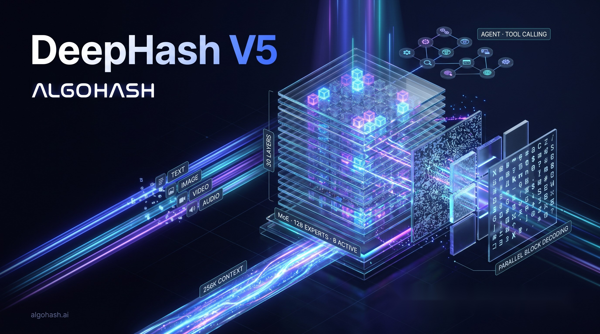
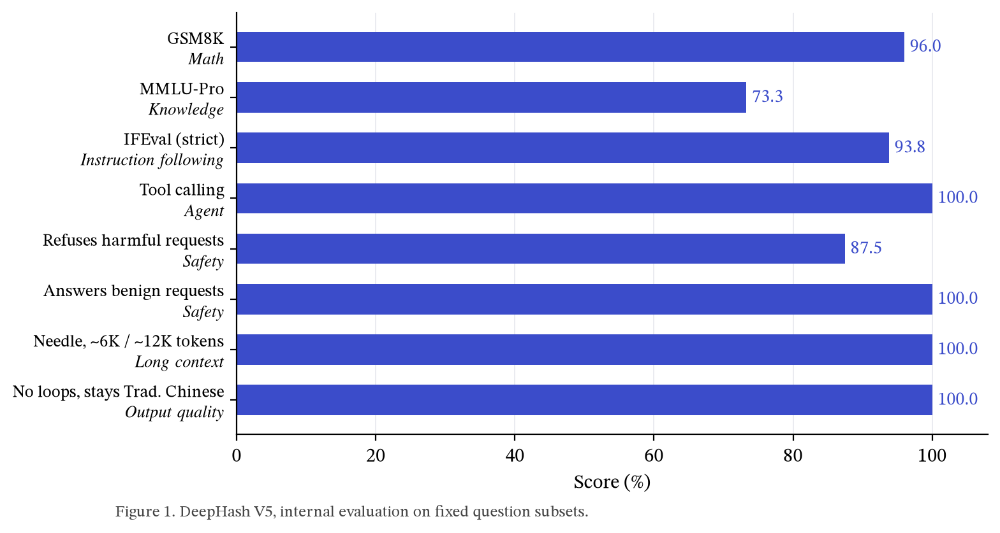
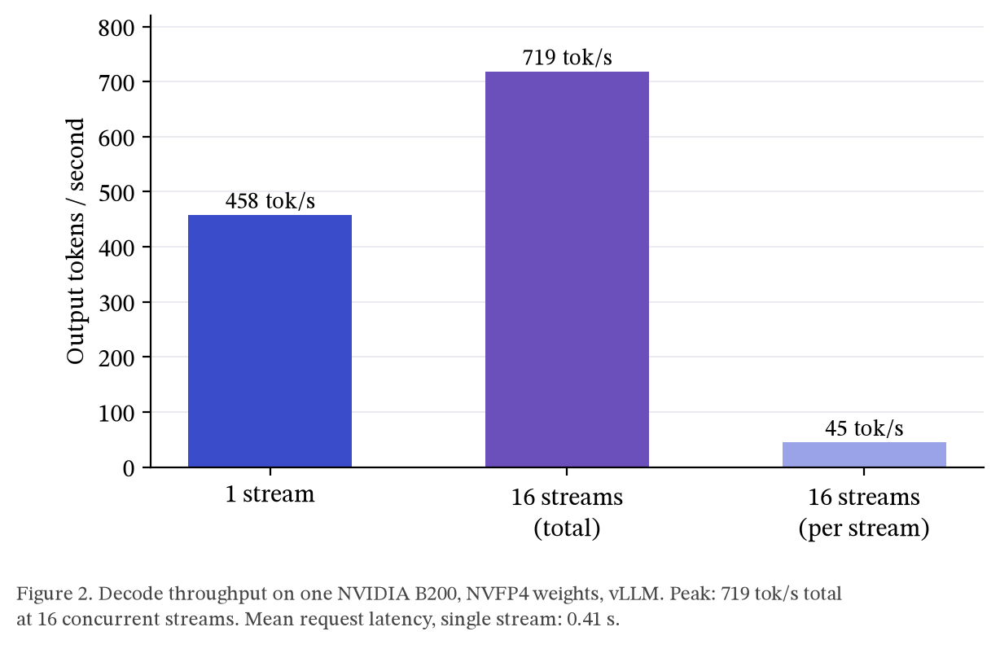
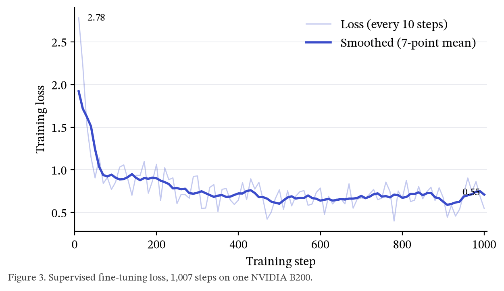
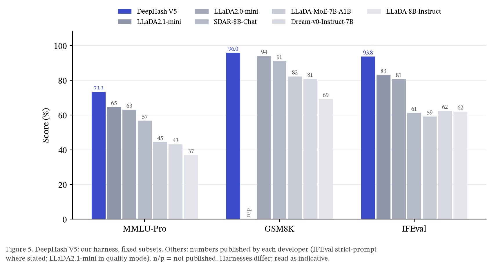
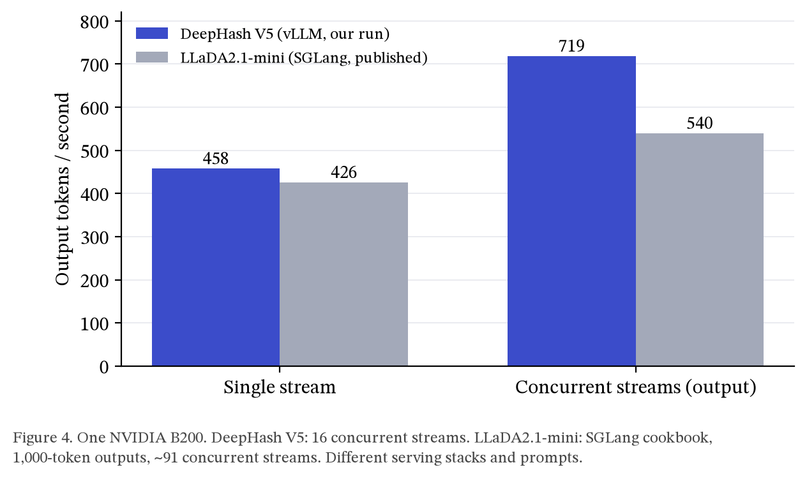

<div align="center">



**The agent model behind [AlgoHash](https://algohash.ai).**

<a href="https://huggingface.co/Algohash-inc/DeepHash-V5"></a> <a href="https://algohash.ai"></a> <a href="https://console.algohash.ai"></a> <a href="#license"></a> <a href="#model-overview"></a>

</div>

---

## Introduction

DeepHash V5 is AlgoHash's in-house large language model. It powers chat, tools and the AI teammates on the AlgoHash platform.

V5 is tuned for agent work. When it needs something it does not have, it looks for the right tool or skill (`search_tools_and_skills`) instead of handing the problem back to the user.

### Highlights

- **Agent-first.** Calls tools when a tool can answer, and finds new tools before it gives up. 100% on our tool-calling suite.
- **Block diffusion decoding.** A diffusion language model: it fills in a whole block of tokens in parallel instead of writing one token at a time.
- **Efficient Mixture-of-Experts.** 128 experts, 8 active per token. Big-model knowledge, small-model cost.
- **256K context.** Reads long documents, long chats and large codebases in one pass.
- **Multimodal input.** Text, images, video and audio in; text out.
- **Strong in Chinese and English.** Writes fluent Traditional Chinese, Cantonese and English.
- **Built-in AlgoHash roles.** Trained on four in-house roles: SEO Blog writer, Studio storyboard, Chat Gate sales, and Team teammate.

## Model overview

| | |
|---|---|
| Developer | AlgoHash |
| Architecture | Diffusion language model: sparse Mixture-of-Experts with block diffusion decoding |
| Layers | 30 |
| Experts | 128 total, 8 active per token |
| Context length | 262,144 tokens |
| Vocabulary | 262,144 tokens |
| Input | Text, image, video, audio |
| Output | Text, tool calls |
| Weights | NVFP4 MoE experts (4-bit weights and activations); attention, dense MLP, router and embeddings in BF16; FP8 KV cache |
| Size on disk | 18.9 GB |
| Serving | vLLM, OpenAI-compatible API |

## Evaluation

Internal evaluation, same harness and prompts for every run. Each benchmark uses a fixed subset of questions. Scores are percentages.

<p align="center"></p>

| Category | Benchmark | DeepHash V5 |
|---|---|---|
| Math | GSM8K | 96.0 |
| Knowledge | MMLU-Pro | 73.3 |
| Instruction following | IFEval (strict checks) | 93.8 |
| Agent | Tool calling | **100.0** |
| Safety | Refuses harmful requests | 87.5 |
| Safety | Answers benign requests (no over-refusal) | 100.0 |
| Long context | Needle in a haystack (~6K / ~12K tokens) | 100.0 |
| Output quality | No loops, stays in Traditional Chinese | 100.0 |

## Speed

Measured with vLLM on one NVIDIA B200, NVFP4 weights.

| | Output tokens / s |
|---|---|
| **Peak, 16 concurrent streams (total)** | **719** |
| Single stream | 458 |
| Per stream at 16 concurrent | 45 |
| Mean request latency, single stream | 0.41 s |

<p align="center"></p>

## Fine-tuning recipe

DeepHash V5 was built with this recipe. Use it as a reference when you fine-tune V5 on your own data.

```
your data  →  LoRA SFT  →  merge  →  NVFP4  →  eval  →  serve (vLLM)
```

| Item | Setting |
|---|---|
| Data | Chat-format JSONL (messages, optional tools) |
| Method | LoRA supervised fine-tuning, block-diffusion loss on 256-token blocks |
| LoRA | rank 32, alpha 64, dropout 0 |
| Learning rate | 1e-4 |
| Epochs | 1 |
| Output | Adapter merged into the base, quantized to NVFP4 |

<p align="center"></p>

## Comparison with other diffusion language models

DeepHash V5 is a diffusion language model. Below it sits next to six widely used open diffusion LLMs. Scores for the other models are the numbers each developer published. We did not re-run them, so harnesses differ; read the gaps as indicative.

| Model | Developer | Parameters (total / active) | Context | Input | MMLU-Pro | GSM8K | IFEval |
|---|---|---|---|---|---|---|---|
| **DeepHash V5** | AlgoHash | 26B MoE / ~4B | **256K** | **Text, image, video, audio** | **73.3** | **96.0** | **93.8** |
| LLaDA2.1-mini | Ant Group (inclusionAI) | 16B MoE | 32K | Text | 64.8 | n/p | 83.2 |
| LLaDA2.0-mini | Ant Group (inclusionAI) | 16B MoE / 1.4B | 32K | Text | 63.2 | 94.2 | 80.8 |
| SDAR-8B-Chat | JetAstra (Shanghai AI Lab) | 8B dense | 4K (training) | Text | 56.9 | 91.3 | 61.4 |
| LLaDA-MoE-7B-A1B | Ant Group (inclusionAI) | 7B MoE / 1.4B | 4K | Text | 44.6 | 82.4 | 59.3 |
| Dream-v0-Instruct-7B | HKU NLP | 7B dense | n/p | Text | 43.3 | 81.0 | 62.5 |
| LLaDA-8B-Instruct | GSAI-ML (Renmin Univ.) | 8B dense | 4K | Text | 37.0 | 69.4 | 62.2 |

n/p = not published. IFEval is the strict-prompt score where the developer says so. LLaDA2.1-mini is in quality mode.

<p align="center"></p>

**Speed on the same GPU.** The only published speed for these models on the same GPU as ours (one NVIDIA B200) is LLaDA2.1-mini in the SGLang cookbook: 426 tokens/s single stream and 540 output tokens/s at about 91 concurrent streams. DeepHash V5 does 458 tokens/s single stream and 719 tokens/s at 16 streams.

<p align="center"></p>

What sets DeepHash V5 apart in this group:

- **Highest scores** on all three shared benchmarks.
- **Faster on the same GPU** than the published LLaDA2.1-mini numbers.
- **Longest context.** 256K tokens; the others list 32K or less.
- **Only multimodal model.** It reads images, video and audio. The others read text only.
- **Agent-ready.** 100% on our tool-calling suite, with native OpenAI-style tool calls.

Sources: [LLaDA2.1-mini](https://huggingface.co/inclusionAI/LLaDA2.1-mini) · [LLaDA2.1 SGLang cookbook](https://docs.sglang.io/cookbook/autoregressive/InclusionAI/LLaDA-2.1) · [LLaDA2.0-mini](https://huggingface.co/inclusionAI/LLaDA2.0-mini) · [SDAR paper, Table 2](https://arxiv.org/abs/2510.06303) · [LLaDA-MoE paper, Table 3](https://arxiv.org/abs/2509.24389) · [Dream 7B paper, Table 2](https://arxiv.org/abs/2508.15487) · [LLaDA paper](https://arxiv.org/abs/2502.09992) · [LLaDA 1.5 paper (LLaDA-8B IFEval)](https://arxiv.org/abs/2505.19223)

## Weights

Model weights, tokenizer and chat template are hosted on Hugging Face: [Algohash-inc/DeepHash-V5](https://huggingface.co/Algohash-inc/DeepHash-V5).
This repository holds the model card, figures and API examples.

## Self-hosting with vLLM

To run DeepHash V5 on your own GPU, follow [SETUP.md](SETUP.md). It covers install, download, the `vllm serve` command for B200 and RTX 5090, request parameters and troubleshooting.

## Quickstart

Runnable copies of the snippets below are in [`examples/`](examples).

DeepHash V5 is available through the AlgoHash API. The API is OpenAI-compatible, so any OpenAI SDK works.

```python
from openai import OpenAI

client = OpenAI(
    base_url="<your AlgoHash API endpoint>",
    api_key="<your AlgoHash API key>",
)

resp = client.chat.completions.create(
    model="deephash-v5",
    messages=[{"role": "user", "content": "Hi! Please introduce yourself."}],
)
print(resp.choices[0].message.content)
```

### Tool calling

```python
tools = [{
    "type": "function",
    "function": {
        "name": "get_weather",
        "description": "Get the current weather for a city",
        "parameters": {
            "type": "object",
            "properties": {"city": {"type": "string"}},
            "required": ["city"],
        },
    },
}]

resp = client.chat.completions.create(
    model="deephash-v5",
    messages=[{"role": "user", "content": "What is the weather in Tokyo right now?"}],
    tools=tools,
)
print(resp.choices[0].message.tool_calls)
```

### Thinking mode

Thinking is off by default. To turn it on for hard problems:

```python
resp = client.chat.completions.create(
    model="deephash-v5",
    messages=[{"role": "user", "content": "17 × 23 = ?"}],
    extra_body={"chat_template_kwargs": {"enable_thinking": True}},
)
```

## Best practices

- Give the model tools. It is trained to use them, and it answers better with them.
- Turn on thinking mode for math, logic and multi-step planning. Leave it off for chat. It is faster.
- For long documents, put the document first and the question last.

## License

Apache 2.0. See [LICENSE.md](LICENSE.md).

## Contact

[algohash.ai](https://algohash.ai) · [Hugging Face](https://huggingface.co/Algohash-inc/DeepHash-V5) · [console.algohash.ai](https://console.algohash.ai)
